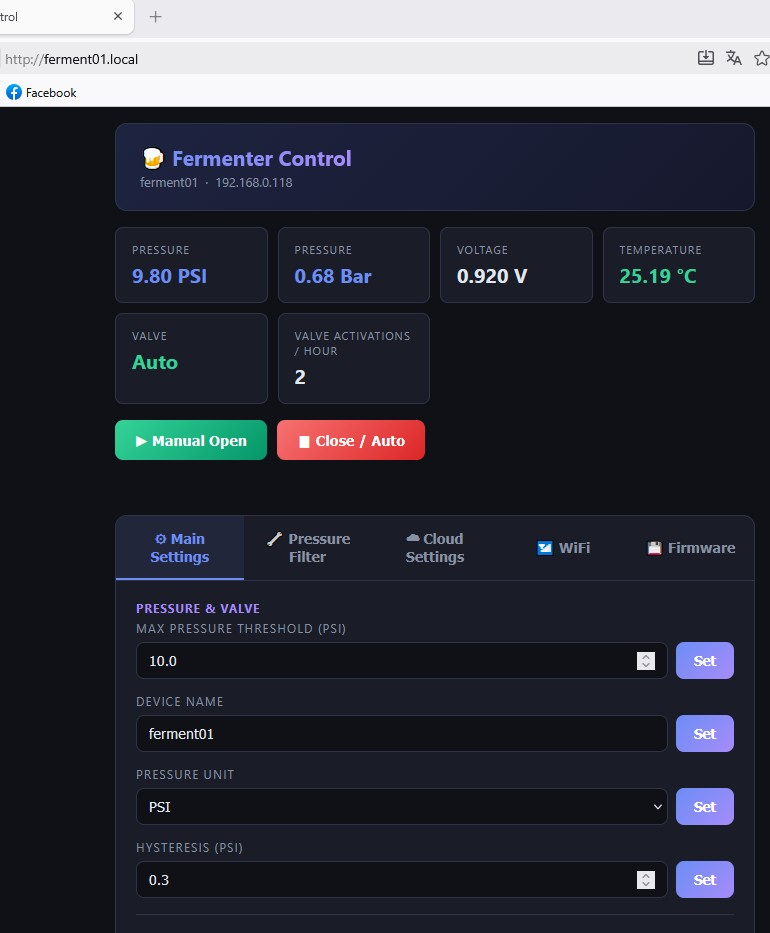

🌐 **English** | [Русский](README.ru.md)

# FermentPressureTool

A device for monitoring and controlling the fermentation process with real-time pressure and temperature measurement.

## 📋 Project Overview

**FermentPressureTool** is an ESP32-based IoT device designed for precise fermentation condition control. It reads pressure and temperature inside a fermentation vessel, uploads data to cloud services, and controls a pressure relief valve.

<p align="center">
   
</p>

### Key Features

- 📊 **Pressure monitoring** — analog pressure sensor reading via ADC
- 🌡️ **Temperature measurement** — DS18B20 sensor support over OneWire
- 📡 **Cloud integration** — data upload to:
  - **Brewfather** (homebrewing platform)
  - **ThingSpeak** (IoT platform)
  - **Custom HTTP API** (flexible integration)
- 🖥️ **Web interface** — browser-based control and monitoring
- 🔧 **Configuration portal** — WiFi setup without reflashing
- 📱 **OLED display** — alternating pressure and temperature display (SSD1306, 128×64)
- 🤖 **Multithreading** — parallel execution of sensor and network operations
- 💾 **Persistent settings** — stored in Preferences/NVS

## 🛠️ Hardware

### Microcontroller
- **ESP32-DevKit** — WiFi-enabled dual-core microcontroller

### Sensors and Modules
- **Pressure sensor** — analog, connected to `GPIO34` (ADC1_CH6)
- **External ADC (optional)** — ADS1115 on the same I2C bus as the OLED (address `0x48`, pressure input `A0`)
- **Temperature sensor** — DS18B20 (OneWire)
  - DATA: `GPIO4`
  - 4.7 kΩ pull-up resistor required between DATA and VCC
- **OLED display** — SSD1306 128×64 (I2C, address 0x3C)
- **Solenoid valve** — controlled via `GPIO27`

### Connections
- Serial (UART) at 115200 baud for debugging
- CH340 USB-UART converter for programming

### Pressure ADC selection

The web settings provide a choice between the built-in ESP32 ADC and an external ADS1115.
The ESP32 mode keeps the existing voltage divider on `GPIO34`. In ADS1115 mode, connect the
pressure sensor directly to `A0`; the divider is not used because this input supports the
sensor's 0.5-4.5 V signal range. Connect `VDD`, `GND`, `SDA`, and `SCL` to the board and tie
`ADDR` to `GND` for address `0x48`. The ADS1115 and ESP32 must share ground. Do not exceed the
ADS1115 supply voltage or its absolute input limits.

### Pressure sensor range

In the main settings tab, under **Sensor & Calibration**, set **Sensor Max Pressure (PSI)**
to the full-scale pressure printed on your sensor (for example, `100` for a 0-100 PSI sensor).
The default is `100` PSI, including after upgrading existing devices. The value must be a
positive finite number, is saved in NVS, and takes effect without a reboot for both ADC sources.
It always uses PSI regardless of the display unit. The 0.5-4.5 V signal span and voltage
offset calibration are unchanged; this setting does not change the valve pressure threshold.
The API exposes `sensorMaxPsi` via `GET /api` and accepts it via `POST /api`.

### Recommended settings for external ADC

When using the external ADS1115, the following settings are recommended for stable and responsive
pressure readings:

- Median Sample Count (odd, 3-31): `5`
- Median Sample Delay (ms): `10`
- Update Interval (ms): `50`

These values reduce sensor noise while keeping the UI and pressure control responsive enough for
fermentation monitoring.

When using the external ADS1115, the adaptive filter can be disabled if the ADC already provides a
stable signal and additional smoothing is not needed.

## 📁 Project Structure

```
FermentPressureTool/
├── src/
│   ├── main.cpp                 # Entry point, initialization
│   ├── config.h                 # Central constants (pins, parameters)
│   ├── Settings.h/cpp           # Persistent settings management
│   ├── CloudManager.h/cpp       # Cloud provider coordination
│   ├── ConfigPortal.h/cpp       # WiFi configuration portal
│   ├── web_server.h/cpp         # REST API and web interface
│   ├── RuntimeState.h           # Shared state between cores
│   ├── debug.h                  # Debug macros
│   ├── html_template.h          # Web UI HTML
│   ├── cloud/
│   │   ├── CloudProvider.h      # Base provider interface
│   │   ├── BrewfatherProvider.h/cpp
│   │   ├── ThingSpeakProvider.h/cpp
│   │   └── CustomHTTPProvider.h/cpp
│   └── device/
│       ├── DisplayManager.h/cpp      # OLED display management
│       ├── OledMirror.h/cpp          # Passive Ferminator OLED mirror
│       ├── SensorManager.h/cpp       # Sensor reading (pressure, temperature)
│       └── SolenoidController.h/cpp  # Valve control
├── include/                     # User libraries
├── lib/                         # External libraries
├── test/                        # Tests
├── platformio.ini               # PlatformIO configuration
└── README.md                    # This file
```

## 🔌 Software Components

### CloudManager
Coordinates data upload to cloud platforms. Supports multiple simultaneous providers.

### ConfigPortal
WiFi configuration portal for initial setup and reconfiguration without reflashing.

### SensorManager
- ADC initialization and eFuse-based calibration
- Filtered pressure reading (average of N samples)
- DS18B20 temperature reading over OneWire

### DisplayManager
Manages the SSD1306 OLED display, alternating between pressure and temperature. The switch interval is configurable via the web interface.

### WebServer
REST API for:
- Retrieving current sensor data
- Controlling the valve
- Changing system parameters
- Triggering cloud uploads

### SolenoidController
Controls the solenoid valve for pressure relief.

## 🚀 Getting Started

### Requirements
- **PlatformIO** — embedded build system
- **VS Code** with the PlatformIO extension
- **CH340 driver** — for USB programming

### Dependencies
Declared in `platformio.ini`:
```
adafruit/Adafruit SSD1306 @ ^2.5.9
adafruit/Adafruit GFX Library @ ^1.11.9
adafruit/Adafruit BusIO @ ^1.14.5
paulstoffregen/OneWire @ ^2.3.8
milesburton/DallasTemperature @ ^4.0.4
```

### Build and Flash

1. **Open the project in VS Code**
   ```bash
   code d:\Projects\FermentPressureTool
   ```

2. **Connect the ESP32 via USB**

3. **Select the environment in PlatformIO**
   - Choose `esp32s` from the available environments

4. **Build the project**
   ```bash
   pio run -e esp32s
   ```

5. **Upload the firmware**
   ```bash
   pio run -e esp32s --target upload
   ```

6. **Open the serial monitor**
   ```bash
   pio device monitor -e esp32s
   ```

## ⚙️ Configuration

### Build Flags
Debug flags defined in `platformio.ini`:
- `APP_DEBUG_SERIAL=0` — debug level (0 = disabled)

### Hardware Pins (`src/config.h`)
All pins are defined centrally in `config.h`. Edit the values before building as needed.

### Ferminator OLED Mirror
- In **Main Settings**, **Ferminator Control** is disabled by default, including on upgrades without a saved setting. Enable it only on the controller connected to the Ferminator; the choice is stored separately in each device's NVS.
- When disabled, the Ferminator OLED panel is not rendered, the capture task/interrupt and GPIO8/9 monitoring are not started, `/oled` returns HTTP 403, and Ferminator OLED status/timing fields are omitted from `/api`. Pressure/valve control, local OLED, optional temperature sensing and cloud integrations continue to work.
- Changing this setting saves it and automatically restarts the device; the portal waits for reconnection and reloads. Saving the same value does not restart it. This enables the existing OLED mirror, not the still-unimplemented optocoupler buttons.
- Connect `GPIO8` to the Ferminator I2C SCL line and `GPIO9` to SDA.
- These lines are monitored passively: firmware does not act as an I2C master and sends no ACKs or data.
- Connect in parallel to the OLED bus and share GND. ESP32 inputs are 3.3 V; do not connect directly to a bus pulled up to 5 V.
- Supports SH1106 128x64 display data at address `0x3C` or `0x3D`. It accounts for the controller's 132-column RAM and the 2-column visible-area offset; the web portal shows the display after the full visible area is captured.
- Orientation follows the module's A1/C8 mounting convention. Frame metadata is sent in `X-OLED-*` headers with the matching pixels, not taken from a separate status request.
- `/oled` remains a 1024-byte page-order binary frame. Headers: `X-OLED-Sequence`, `X-OLED-Start-Line`, `X-OLED-Display-Offset`, and `X-OLED-Flags` (bits 0–4: display enabled, all on, inverse, segment remap, reverse COM scan).
- Command parameters can span I2C transactions. A capture error invalidates only the candidate refresh: the last accepted frame stays available, with its original timestamp and sequence.
- Capture uses a dedicated level-3 IRAM GPIO interrupt on the setup core (core 1), away from Wi-Fi/cloud tasks, not Arduino per-pin callbacks. ADC/OneWire sensor work runs on core 0 to avoid masking capture interrupts. It owns the GPIO interrupt source; do not combine it with `attachInterrupt`/the GPIO ISR service without redesigning capture.
- A START interrupt begins direct GPIO sampling until STOP, bounded to 20 ms per transaction. This avoids per-edge interrupt dispatch latency, but can delay other work on core 1 by up to 20 ms. It targets the test stand's 100 kHz, at-most-128-byte data chunks; longer/clock-stretched transactions time out.
- Incomplete byte boundaries, capture timeouts, malformed transfers and buffer overflows invalidate coverage. `oledCaptureErrors` in `/api`, the web status and Serial report synchronization loss independently of buffer overflows. These counters cannot detect every possible corrupted byte (I2C has no payload checksum).
- Publication requires one complete, sequential refresh of the visible RAM, from page 0/column 2 through page 7/column 129, followed by at least 3 ms of idle decoded traffic. Gaps, repeated addresses and restarts discard the candidate instead of accumulating coverage across different refreshes. This deliberately targets full-frame writers such as the test stand; partial-only updates or other page orders do not publish new frames.
- `/api` exposes `oledDroppedFrames` and `oledRecovering`. During reacquisition the web explicitly holds the last complete frame; capture errors remain visible rather than being suppressed. Each page selection requires both column-address nibbles before accepting data.
- `oledFrameTiming` records successful full-frame publications independently of browser polling: frame/interval counts, observation duration, current wait, last/minimum/mean/maximum completed interval (milliseconds), and six non-overlapping gap buckets (`<=1500`, `1501-3000`, `3001-5000`, `5001-10000`, `10001-30000`, `>30000` ms). Before two successes, interval metrics are `null`. The current unfinished wait is not yet included in completed-interval metrics.
- `OledMirrorConfig::SHOW_DEBUG_INFO` in `src/config.h` controls detailed OLED diagnostics in the portal (default `false`). Set it to `true` and rebuild/upload to show frame timing, capture counters, byte coverage and frame age. Basic status and frame-read errors remain visible in either mode; this flag does not change Serial logging.
- Timing statistics accumulate in RAM until reboot and survive page reloads or closing the browser, even with debug display disabled. They remain available through `/api` and are shown under the OLED status when debug display is enabled. No flash writes or per-frame Serial logging are needed. Leave the receiver powered for a half-hour run, then read `/api` without rebooting it.
- Attaching after OLED initialization (or losing synchronization) leaves display settings unknown. The web explicitly labels this as a RAM preview and renders unknown settings in raw RAM order instead of assuming the display is off. Restart the source while the receiver is listening to capture its actual configuration.
- `X-OLED-Known-State` / `oledKnownState` is a bit mask: bits 0–6 indicate observed display enable, segment remap, COM scan, start line, offset, inverse and all-on settings. A value of 127 means all settings were observed.
- Run web mirror regression tests with `node --test test\oled_mirror.test.cjs`. GPIO capture timing still requires verification on the real I2C bus.
- Compile-time C++ frame-order tests: `xtensa-esp32s3-elf-g++ -std=c++11 -fconstexpr-depth=2048 -Wall -Wextra -Werror -Isrc -fsyntax-only test\oled_frame_coverage.cpp` (using the PlatformIO toolchain executable).

### Network Parameters
- **Hostname**: `ferment01` (accessible as `ferment01.local`)
- **Web server port**: 80
- **UART baud rate**: 115200

### Cloud Integrations
Configure API keys and settings via the configuration portal or web interface:
- **Brewfather API Key**
- **ThingSpeak Channel ID and API Key**
- **Custom HTTP URL endpoint**

### OLED and Sensors
- Pressure and temperature are shown alternately on the OLED.
- The switch interval is configurable in the web interface; default is 3 seconds.
- If the temperature sensor is disconnected, only pressure is shown.
- If the pressure sensor is not connected, the display shows `Disconnected` and cloud uploads are skipped.
- The independent Ferminator OLED is passively mirrored in the web portal through `GPIO8`/`GPIO9`.

## 🌐 Cloud Integration

### Brewfather
Integration with the popular homebrewing platform. Sends pressure and temperature data. The temperature field can be configured as Fermenter (`temp`), Room (`ext_temp`), or Fridge (`aux_temp`).

### ThingSpeak
IoT platform for data storage and visualization. Supports measurement history and charts.

### Custom HTTP API
Flexible integration with any HTTP API to send data to a custom backend.

## 📊 REST API

### Get Sensor Data
```
GET /api
```

Response:
```json
{
  "pressure": 1.5,
  "temperature": 22.5,
  "voltage": 2.3,
  "pressureConnected": true,
  "tempConnected": true
}
```

### Get Ferminator OLED Frame
```
GET /oled
```
Returns the visible 1024-byte SH1106 area (`application/octet-stream`); the four non-visible RAM columns are omitted.
Capture status and frame sequence are included in the `GET /api` response.

### Control the Valve
```
POST /api
Body: cmd=manual_on
```

### Cloud Upload
Cloud uploads are performed automatically in the firmware's main loop and are skipped if the pressure sensor is disconnected.

## 🔄 Multithreading Architecture

The system uses tasks on both ESP32 cores:
- **Core 1**: Passive OLED capture interrupt
- **Core 0**: Sensor operations (reading sensors, valve control)
- **Core 0**: Network operations (WiFi, cloud requests, web server) and decoding the captured OLED bus

Synchronization is handled through the `RuntimeState` structure using semaphores.

## 🐛 Debugging

Debug output is sent to UART when enabled:

```cpp
DBG("Debug message here");
```

View the output in the serial monitor.

---

<div align="center">

  <p>
    <strong>FermentPressureTool</strong><br>
    ESP32-based fermentation pressure and temperature monitor
  </p>

  <p>
    <strong>Version</strong> 2.0.2 · <strong>Updated</strong> 2026-10-18
  </p>

  <p>
    Built with PlatformIO for ESP32 • Pressure control • Cloud integration
  </p>

</div>
